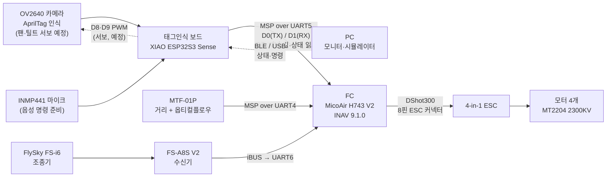

# 01. 시스템 개요

## 목표

노션 계획서(20260930~20261001)의 목표는 다음과 같다.

- 바닥의 AprilTag를 카메라로 찾아 그 위로 이동한다.
- 바닥 기준 50cm에서 3초 머문 뒤 100cm로 올라가 호버링한다.
- 태그인식 보드는 판단만 하고 FC에 이동 명령을 보낸다. 균형 유지와 모터 제어는 FC가 맡는다.
- 사람은 조종기 스위치로 보드에게 조종권을 주거나 되찾는다.
- 보드가 멈추거나 통신이 끊겨도 사람이 조종을 되찾을 수 있어야 한다.

2026-10-10에 추가된 요구:

- **아밍하면 프로펠러가 눈으로 보이게 돌아야 한다** (공회전).
- **보드가 FC를 통해 드론을 멈출 수 있어야 한다** (킬 기능). 배터리 전원을 물리적으로 끊으려면 별도 하드웨어가 필요하므로, 지금은 FC 디스아밍(모터 정지)으로 구현했다.
- **운행 중 카메라 방향을 바꿀 수 있어야 한다** (서보 2개 팬·틸트, [13](13-camera-pan-tilt.md)).

## 전체 구성 (2026-10-10)

- 수신기는 FC에 직접 연결한다. 보드가 멈춰도 조종기 입력은 FC에 닿는다.
- **MTF-01P는 10-10부터 FC UART4에 연결돼 있다.** 보드는 높이를 FC에서 MSP로 받는다(`-21`). 자세한 내용은 [06](06-sensor-mtf01p.md)에 있다.
- 보드가 보내는 조종 값은 INAV **MSP RC OVERRIDE** 모드(ch6)가 켜져 있을 때만, 그리고 지정한 채널에만 적용된다. 지금은 킬 채널(ch7)만 열려 있다([07](07-fc-msp-integration.md)).

## 부품

| 구분 | 부품 | 상태 |
|---|---|---|
| 태그인식 보드 | Seeed XIAO ESP32S3 Sense (OV2640 카메라 확장 보드 포함) | 동작 중. 뒤집어 장착해 카메라가 아래를 봄 |
| 거리·플로우 센서 | MicoAir MTF-01P | **FC UART4 연결**, FC에서 정상 (MSP 출력 모드) |
| 마이크 | INMP441 (I2S) | 배선 완료, 펌웨어 포함, 실기 시험 전 |
| FC | MicoAir H743 V2 (보드 표기 MicoAir743 V2.1), INAV 9.1.0 | 동작 중 |
| 수신기 · 조종기 | FlySky FS-A8S V2 · FS-i6 | 동작 중 (iBUS, 6채널) |
| ESC | 4-in-1, FC와 8핀 1:1 연결 | **신호에 반응하지 않음**. 노션에는 BLS 50A로 적혀 있었고, 10-10 사용자 제공 배선도는 MicoAir 4IN1 Bluejay-48K. 실물 표기 확인 필요 |
| 모터 | ReadyToSky MT2204 2300KV ×4 | 보통 2~3S용 |
| 카메라 팬·틸트 | 서보 2개 + 2축 브래킷 (MG90S 권장) | 펌웨어 작성 중, 하드웨어 미장착 |
| 전원 (시험) | 안정화 전원 13.6V | FC가 4S 저전압으로 오인 → 12.0~12.6V 권장 ([12](12-issues-next-steps.md)) |
| 기체 | 전용 프레임, 약 80% 완성 (노션 기준) | 제작 중 |
| 시각 표식 | AprilTag tag36h11 ID 10, 한 변 200mm 패널 | 제작 완료 |
| | ID 0, 한 변 100mm (저고도용) | 출력 예정 |

## 진행 경과

### 2026-10-03

1. 노션 계획서를 가져와 정리했다.
2. 보드에 있던 `RIDER-SERIAL-20260924-06` 펌웨어의 출력(MTF-01P JSON)을 분석하고, 플래시 8MB 전체를 백업했다.
3. 카메라 + AprilTag + MTF-01P 펌웨어를 새로 만들어 올렸다. 패널 태그는 ID 10으로 인식됐다.
4. 태그별 크기·착륙 지점 오프셋(중첩 태그)과 decimate 자동 전환을 넣었다.
5. FC로 보내는 MSP 송신, 미션 단계, 안전 장치를 넣었다.
6. 브라우저 시뮬레이터(화면에 태그를 그려 실제 카메라로 보는 폐루프)를 만들었다.
7. FC 설정 전체를 읽어 문서로 정리했다.
8. MTF-01P 출력 형식 변경(MSP)에 대응했고, 블루투스(BLE) 연결을 넣어 안정화했다.
9. FC와의 MSP 통신을 확인했다. UART5를 켜고 신호선을 바꾼 뒤 정상이 됐다.
10. 모터 시험 명령으로 신호를 보냈다. FC는 받았지만 모터는 돌지 않았다.
11. INMP441 마이크와 음성 명령 구조를 만들었다.

### 2026-10-10

1. TypeSafe 스킬을 설치하고, 이 프로젝트에서 쓰기로 했다(음성 명령 해석에 사용 예정).
2. 펌웨어 `-19`: 보드가 FC 상태(아밍 차단 사유, 전압·전류, 모터 출력)를 읽고, `kill`·`fcmsp` 명령을 넣었다.
3. FC의 아밍을 막던 원인을 찾았다. USB CLI가 열린 채로 남아 `CLI` 차단이 걸려 있었다.
4. 사용자가 FC 모드·포트를 다시 설정했다. ARM = ch5, MSP RC OVERRIDE = ch6, ANGLE = ch8(항상)이고, MTF-01P는 UART4로 옮겼다.
5. 킬 기능을 FC에 설정했다(FAILSAFE = ch7, `msp_override_channels = 64`). 펌웨어 `-20`으로 킬 채널을 ch7로 옮겼다.
6. **킬 기능을 시험했다(프로펠러 없이).** 디스아밍 상태에서는 아밍이 차단됐고, 아밍 상태에서는 즉시 디스아밍됐다.
7. 아밍해도 공회전하지 않던 FC 쪽 원인(`motorstop_on_low = ON`)을 찾아 OFF로 바꿨다.
8. 모터 시험을 8%로 다시 했다. FC 출력은 정상이지만 전류가 변하지 않았다. 원인은 FC 다음 단계(ESC 쪽)로 좁혀졌다.
9. 사진과 제조사 문서로 FC 쪽 ESC 커넥터, 출력 핀, 포트 배정을 확인했다. 모두 정상이다.
10. 카메라 팬·틸트(서보 2개)와 FC 높이 사용을 위한 펌웨어 `-21`을 작성 중이다.

자세한 측정값은 [11. 시험 기록](11-test-log.md)에 있다.
