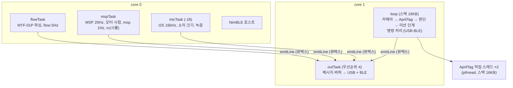

# 04. 펌웨어 (`tag-board-fw/`)

- 플랫폼: PlatformIO `espressif32@6.9.0` (arduino-esp32 2.0.17), 보드 `seeed_xiao_esp32s3`, 최적화 `-O2`
- 라이브러리:
  - AprilTag: [raspiduino/apriltag-esp32](https://github.com/raspiduino/apriltag-esp32) v3.4.0 (BSD-2)를 `lib/apriltag`에 포함
  - BLE: `h2zero/NimBLE-Arduino@1.4.3` (2.x는 이 코어와 맞지 않음)
- 현재 보드에 올라간 빌드는 `TAGVISION-20261003-17`이다. 저장소의 소스는 `-18`(마이크 포함)까지 진행돼 있다.

## 구조



- 출력은 모두 `emitLine()` → FreeRTOS 메시지 버퍼 → `outTask` 한 곳에서 USB와 BLE로 내보낸다.
  - 메시지 버퍼는 쓰는 쪽이 하나여야 안전해서 뮤텍스로 묶는다.
  - USB 쓰기를 core 1 한 곳에서만 하는 이유는 [02](02-xiao-esp32s3-sense.md)에 있다.
- 공유 상태(MTF 값, 판단, MSP 통계, 모터 시험)는 `portMUX` 임계 구역으로 보호한다.

## 소스 파일

| 파일 | 역할 |
|---|---|
| `src/main.cpp` | 작업 흐름 전체: 카메라·AprilTag, 판단·미션, MSP, 명령, 출력 |
| `src/config.h` | 핀, 주기, 제어 이득, 미션 고도, 태그 표, 음성 명령 표 등 모든 설정 |
| `src/mtf01p.h` | MTF-01P 파서 (Micolink + MSP v2 자동 구분) |
| `src/msp.h` | MSP v1 프레임 생성·해석 (하드웨어 무관, PC 테스트 대상) |
| `src/ble_link.h/.cpp` | BLE Nordic UART Service |
| `src/mic.h/.cpp`, `src/adpcm.h` | INMP441 입력, 녹음 ADPCM 압축 (`-18`) |
| `lib/apriltag/` | AprilTag 라이브러리. **tag36h11 코드를 원본 587개로 복원**했다. 이 포트는 메모리 때문에 35개(ID 0~34)로 줄여 놓았었다 |
| `test/` | PC 테스트: MSP 프레임, MTF 파서, ADPCM 왕복 |

## 빌드·업로드·복구

```bash
cd tag-board-fw
pio run -t upload --upload-port /dev/cu.usbmodem2101

# 원래 펌웨어(RIDER-SERIAL-20260924-06)로 되돌리기 (D4D 폴더에서)
python3 ~/.platformio/packages/tool-esptoolpy/esptool.py --port /dev/cu.usbmodem2101 \
  write_flash 0 firmware-backup/RIDER-SERIAL-20260924-06_full8MB.bin
```

- 백업 SHA256: `0455ced91d45eef0207160dd5ec3f9e25a8326daf4315f4a5a34de6e73d5e443`
- 업로드에는 USB 연결이 필요하다. 블루투스 OTA 업데이트는 없다.

## 주요 설정값 (`config.h`)

| 항목 | 값 |
|---|---|
| 카메라 | VGA 640×480 회색조, 수평 화각 55° (fx 약 615px) |
| AprilTag | tag36h11, 오류 정정 1비트, 작업 스레드 2개, margin 30 미만 버림 |
| decimate | 자동 (시작 3.0, 2.0/3.0/4.0 중 선택) |
| 정렬 판정 | 착륙 지점이 화면 중심에서 3cm 이내 |
| 축 매핑 | `CAM_ROTATE_DEG 0`, `AXES_VERIFIED false` (실측 전) |
| MSP 송신 | 20Hz, 8채널(AETR + AUX4), MSP_RC 확인 요청은 4번에 1번 |
| 제어 이득 | 롤·피치 4µs/cm, 최대 ±80µs. 스로틀 3µs/cm, 최대 ±60µs |
| 스로틀 제어 | `CTRL_THROTTLE_ENABLED false` (실제 FC로는 항상 1500. 시뮬레이터에만 허용) |
| 미션 | 50cm → 3초 유지 → 100cm, 도달 판정 ±5cm |
| 모터 시험 한도 | 15%(1150), 5초 |
| 시뮬레이션 | `simh`가 2초간 없으면 실제 센서로 복귀 |
| 마이크 (`-18`) | 16kHz, 이득 ×16, 녹음 최대 3초 |
| 메모리 | 카메라·BLE 초기화 뒤 `heap_caps_malloc_extmem_enable(32)`: 32바이트 이상 할당은 PSRAM으로 |

## 명령 (USB·BLE 공통, 한 줄 + 줄바꿈)

| 명령 | 동작 |
|---|---|
| `info` | 현재 상태·설정 출력 |
| `snap` | 카메라 화면 JPEG (base64를 1000자씩 나눈 줄, `SNAP_BEGIN` … `SNAP_END`) |
| `tags` | 태그 표 출력 |
| `size <id> <mm>` | 태그 한 변 길이 설정 (NVS 저장) |
| `land <id> <x> <y>` | 태그 중심 → 착륙 지점 오프셋(mm), 인쇄물 기준 오른쪽 +x, 위쪽 +y (NVS 저장) |
| `reset <id>` | 그 태그의 NVS 설정 삭제 |
| `dec auto` / `dec <1.0~4.0>` | decimate 자동 / 수동 고정 (카메라가 없으면 거부) |
| `msp on` / `msp off` | FC로 MSP 송신 켜기/끄기 (끄면 INAV가 약 0.7~0.9초 안에 조종기로 복귀) |
| `mission reset` | 미션 단계를 '정렬'로 |
| `simh <cm>` / `sim off` | 시뮬레이션 고도 / 즉시 종료 |
| `mtfraw` | MTF-01P에서 들어오는 다음 64바이트를 hex로 |
| `motortest <1~4\|all> <퍼센트> <초>` | 아밍 전 모터 시험. FC 응답 없으면 거부, 15%·5초 상한 |
| `motorstop` | 모터 시험 즉시 정지 |
| `rec <초>` (`-18`) | 0.2~3초 녹음 → `MIC_BEGIN` … `MIC_END` |
| `voicecmd <키워드>` (`-18`) | 음성 명령 표의 명령 실행 (모터 시험·아밍 불가) |

## 출력 메시지 (한 줄에 JSON 하나)

| type | 주기 | 주요 필드 |
|---|---|---|
| `boot` / `info` | 부팅 / 요청 시 | build, camera_sensor, frame, decimate, dec_mode, msp, fc_tx/rx, sim, ble, ble_connected, ble_mtu, ble_dropped, ble_buf, ram_min, ram_largest, heap_free, psram_free, dropped_lines |
| `tags` | 부팅 / 요청 시 | id, size_mm, land_x_mm, land_y_mm, meaning |
| `flow` | 5Hz | connected, height_cm, forward/right/up_cm_s, raw_x/y, quality, flow_status, tof_status, packets, errors, proto(micolink/msp), sim |
| `tag` | 태그마다 | id, registered, meaning, side_px, rot_deg, tag_size_mm, land_px, img_right/up_cm, dist_est_cm, margin |
| `target` | 미션 태그가 보이는 프레임마다 | id, decision(OVER_TARGET/MOVE), move_ko, next_ko, phase, body_right/fwd_cm, offset_cm, height_cm, decimate, candidates |
| `vision` | 2Hz | fps, detect_ms, ids, target_id, decimate_used/next, dec_mode, dec_reason, phase |
| `msp` | 1Hz | enabled, fc_link, sent, acks, rc_replies, errors, out(보낸 값), fc_rc(FC가 쓰는 값: 롤·피치·**요·스로틀**·AUX), phase |
| `rc` | 시뮬레이션 중 20Hz | ch(롤·피치·스로틀·요), seen, centered, phase, sim_h |
| `motortest` | 시험 시 | state(running/stopping/stopped), motors, value, fc_acks |
| `mic` (`-18`) | 1Hz | ok, rms_db, peak_db, slot, ch_db, recording |
| `voice` (`-18`) | 실행 시 | keyword, ko, commands |
| `mtf_raw` | 요청 시 | hex |
| `cmd_error` / `help` | — | reason / commands |

## 버전 이력 (모두 2026-10-03)

| 빌드 | 바뀐 점 |
|---|---|
| `-01` | 첫 버전: 카메라 + AprilTag + MTF-01P, JSON 출력, 스냅샷. USB 출력이 잘리는 문제를 core 1 출력 태스크로 해결 |
| `-02` | 패널 ID 10 등록, 화각 55° 보정, decimate 3.0 |
| `-03` | 태그별 크기와 착륙 지점 오프셋(중첩 태그), decimate 자동 전환, `target` 메시지 |
| `-04` | FC로 MSP 송신(UART2, D0·D1), 미션 단계, `msp on/off`, 메시지 버퍼 다중 작성자 버그 수정 |
| `-05` | 시뮬레이션 모드 (`simh`, `rc`) |
| `-06` | MTF-01P Micolink·MSP 자동 구분, 카메라 없이도 명령 처리, `mtfraw` |
| `-07` | 블루투스(BLE) |
| `-08`~`-16` | BLE 안정화: USB 대기 정책, 전송 버퍼 24개와 예비분, 알림 간격 4ms, 연결 직후 파라미터 요청 제거(컨트롤러 assert), 검출 메모리를 PSRAM으로(내부 RAM 고갈) |
| `-17` | `motortest`/`motorstop`, 부팅 시 정지 신호 — **현재 보드에 올라간 버전** |
| `-18` | INMP441 마이크, `rec`, `voicecmd` — 빌드 완료, 업로드 대기 |
