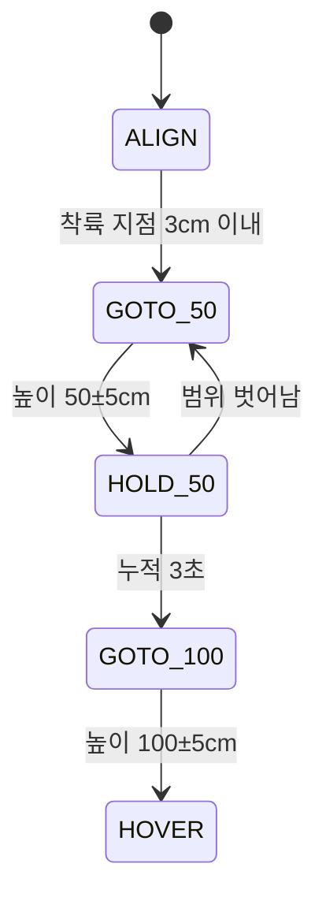

# 07. FC 연동 (MSP)

FC 설정 전체는 [드론 FC 정보 정리 문서](https://claude.ai/code/artifact/1369af2b-fbe6-4b09-942e-8c66aa56f68b)와 `fc-info/`에 있다(`diff_all.txt`는 복원용 백업). 여기에는 보드 연동에 필요한 내용만 적는다.

## FC 요약 (2026-10-03 조회)

| 항목 | 값 |
|---|---|
| 보드 · 펌웨어 | MicoAir H743 V2 (STM32H743 480MHz), INAV 9.1.0, 타깃 MICOAIR743V2 |
| 센서 | BMI088 · SPL06 · QMC5883 정상. GPS·거리센서·옵티컬플로우 없음 |
| 수신기 | iBUS → UART6, Channel Map AETR |
| 모드 스위치 | PREARM ← AUX1(ch5), ARM ← AUX2(ch6), ANGLE ← AUX3(ch7) |
| 쓸 수 있는 모드 | 32개. **MSP RC OVERRIDE 있음**, NAV ALTHOLD 있음, **NAV POSHOLD 없음**(위치 센서 없음) |
| 모터 | 쿼드 X, DSHOT300, 공회전 3%, 호버 스로틀 1300, AIRMODE |
| failsafe | DROP (수신 상실 시 모터 정지) |

| UART | 기능 |
|---|---|
| USB · UART1 · UART8 | MSP (UART8은 내장 블루투스) |
| UART2 | MSP DisplayPort (OSD) |
| UART3 | GPS (미연결) |
| UART4 | 비어 있음 |
| **UART5** | **MSP — 태그인식 보드** (처음엔 꺼져 있었고, 2026-10-03에 켬) |
| UART6 | iBUS 수신기 |
| UART7 | ESC 텔레메트리 (RX 전용) |

## 보드 → FC 통신

| 항목 | 값 |
|---|---|
| 형식 | MSP v1 (`$M<` · 크기 · 명령 · 데이터 · XOR 체크섬) |
| 보내는 명령 | `MSP_SET_RAW_RC`(200) 20Hz, 8채널 / `MSP_RC`(105) 4번에 1번 (FC가 실제 쓰는 값 확인) / `MSP_SET_MOTOR`(214) 모터 시험 때 |
| 채널 순서 | 보내는 값은 수신기와 같은 **AETR**(롤·피치·스로틀·요). FC가 돌려주는 `MSP_RC`는 **롤·피치·요·스로틀** 순서 |
| 확인 결과 | UART5를 켜고 신호선을 바꾼 뒤, 755번 보내 754번 응답, 오류 0 |

## MSP RC OVERRIDE 동작 (INAV 소스 `rx/msp_override.c`, `rx/rx.c`)

- **적용 조건:** MSP RC OVERRIDE 모드 스위치가 켜져 있고, `msp_override_channels` 비트에 포함된 채널에만 보드 값이 적용된다.
- **스위치 채널 보호:** 이 모드를 켜는 스위치 채널은 INAV가 자동으로 덮어쓰기에서 뺀다. 보드가 스위치를 대신 켜 둘 수 없다.
- **통신 조건:** INAV는 MSP를 초당 5번 이상 받아야 한다(`docs/Rx.md`). 보드는 20번 보낸다.
- **보드가 멈추면:** 마지막 프레임부터 약 0.7~0.9초 안에 조종기 입력으로 돌아간다(`failsafe_delay` 0.5초 + 0.2초). 그 사이에는 마지막 값을 유지한다.
- **사람이 회수할 때:** 스위치를 내리면 즉시 조종기로 돌아온다.

## 보드가 보내는 값

| 상황 | 롤·피치 | 스로틀 |
|---|---|---|
| 착륙 지점이 3cm 넘게 벗어남 | 1500 ± 4µs/cm, 최대 ±80µs | 1500 |
| 착륙 지점 위 (3cm 이내) | 1500 | 1500 |
| 태그 안 보임 / 판단이 1초 넘게 없음 | 1500 (중립) | 1500 |
| 스로틀 제어를 켠 경우 (기본 꺼짐) | 위와 같음 | 목표 고도와의 차이 × 3µs/cm, 최대 ±60µs |

- 롤 +는 오른쪽, 피치 +는 앞쪽이다.
- INAV 모드에 따라 의미가 다르다. ANGLE에서는 기울기, POSHOLD에서는 속도 명령이다.
- 지금 FC에는 POSHOLD가 없어 ANGLE로 날아야 한다. 시뮬레이터에서는 ANGLE 모드에서 P 제어만으로 진동했다.

## 미션 단계 (펌웨어 `updateMission`)

- 태그를 놓치면 단계는 멈추고 명령은 중립이 된다.
- `mission reset`으로 처음 단계로 돌아간다.
- 알려진 문제: 착륙 지점을 **지나치는 순간에도** 3cm 안에 들어오면 하강 단계로 넘어간다. 시뮬레이터에서 발견했고, 0.5초 이상 머물러야 넘어가도록 고칠 예정이다.

## 보드 연동에 남은 INAV 설정

| 항목 | 현재 | 필요 | CLI |
|---|---|---|---|
| UART5 | MSP 켬 (완료) | — | `serial 4 1 115200 115200 0 115200` |
| MSP RC OVERRIDE 스위치 | 미배정 | 조종기가 실제로 보내는 빈 스위치 채널 | 예: `aux 3 50 3 1700 2100` (AUX4) |
| `msp_override_channels` | 0 | 3 (롤+피치) | `set msp_override_channels = 3` |
| `nav_mc_althold_throttle` | STICK | MID_STICK (보드가 스로틀을 맡을 때만) | `set nav_mc_althold_throttle = MID_STICK` |

- FS-i6가 기본 6채널이라 AUX3(ch7)·AUX4(ch8)는 1500으로 고정돼 있다. 실제로 신호가 오지 않는 것으로 보인다. AUX1·AUX2는 PREARM·ARM이 쓰고 있으니 스위치 채널부터 정해야 한다(10채널 펌웨어로 바꾸는 방법 등).

## 모터 시험 (`motortest`)

- **방식:** INAV Configurator의 모터 시험과 같은 `MSP_SET_MOTOR`다. FC는 **아밍되지 않았을 때만** 이 값을 모터에 내보낸다(`flight/mixer.c`). 정해진 시간이 지나도 스스로 멈추지 않는다.
- **안전장치 (보드):**
  - 시간이 끝나면 정지 신호(1000)를 0.5초 동안 반복한다. 블루투스가 끊겨도 동작한다.
  - 출력은 15%, 시간은 5초까지만 허용한다.
  - FC가 응답하지 않으면 시작을 거부한다.
  - 보드가 켜질 때마다 정지 신호부터 보낸다(시험 도중 재부팅 대비).
- **시험 결과 (2026-10-03, M1→M4 각각 5% 3초):**

| 상태 | FC가 받은 명령 | 실제 모터 |
|---|---|---|
| 디스아밍 | 모터마다 69개 (운전 59 + 정지 10, 계획과 일치) | **돌지 않음** |
| 아밍 스위치 켬 (PREARM·ARM 2000) | 모터마다 69개 | **돌지 않음** (아밍 중에는 이 명령이 원래 무시됨) |

정말 아밍됐다면 공회전 3%로 모터가 돌아야 하는데 돌지 않았다. 따라서 ESC 전원·신호 문제이거나 INAV가 아밍을 거부했을 가능성이 크다. 점검 순서는 [12](12-issues-next-steps.md)에 있다.
