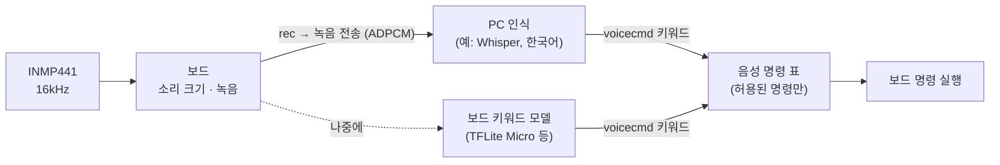

# 09. 마이크·음성 명령

> 상태: 코드 완료, 배선 완료. 마이크 코드는 `-19`부터 보드에 올라가 있다(지금 `-20`). **실기 시험(`level`·`rec`·`cmd`)은 아직 안 했다.**

## 구조

보드는 소리를 받아 녹음하고, 인식기가 알아들은 **키워드**를 받아 정해진 명령만 실행한다. 인식기는 PC든 보드든 같은 구조 위에 붙는다.



## 마이크 입력

| 항목 | 값 |
|---|---|
| 마이크 | INMP441 (I2S 디지털, 24비트) |
| 배선 | SCK → D3, WS → D4, SD → D5, VDD → 3V3, GND, L/R → GND ([03](03-wiring.md)) |
| 샘플링 | 16kHz (음성 인식 표준) |
| 처리 | 32비트 스테레오로 읽고 소리 있는 채널 자동 선택 → 직류 제거 → 24비트를 16비트로(이득 ×16) |
| 보고 | `mic` 메시지 1Hz: 평균·최대 dBFS. 신호가 전혀 없으면 `ok:false` |

## 녹음 (`rec <초>`)

- 0.2~3초를 녹음해 **IMA ADPCM**(4비트, 4:1)으로 줄이고, base64를 1000자씩 나눠 보낸다.
  ```
  MIC_BEGIN <rate> <samples> <adpcm_bytes> <b64_len>
  …base64 줄…
  MIC_END
  ```
- 2초 녹음은 64KB에서 16KB로 줄어 블루투스(약 7KB/s)로 약 3초면 보낼 수 있다.
- 압축 품질: PC 왕복 시험에서 SNR 32.2dB로, 음성 인식에 충분하다.

## 음성 명령 (`voicecmd <키워드>`)

`config.h`의 `VOICE_COMMANDS` 표에 있는 키워드만 실행한다. **모터 시험과 아밍은 음성으로 할 수 없다.** 펌웨어가 `motortest`·`voicecmd`·`fcmsp`를 걸러낸다.

| 키워드 | 말 | 실행 |
|---|---|---|
| `stop` | 정지 / 멈춰 | `motorstop`, `msp off` (모터 시험 중지 + 보드 조종 해제 → 조종기로) |
| `resume` | 다시 시작 | `msp on` |
| `status` | 상태 | `info` |
| `snap` | 사진 | `snap` |
| `mission_reset` | 미션 처음부터 | `mission reset` |
| `cam_down` (`-21`) | 카메라 아래 | `cam down` (팬 0°, 틸트 0°) |
| `cam_front` (`-21`) | 카메라 앞 | `cam front` (틸트 60°, 앞쪽 30° 아래) |

- 킬(`kill`)을 음성 명령에 넣을지는 정하지 않았다. 넣는다면 오인식으로 비행 중 멈추지 않도록, 확신도가 높을 때만 실행하는 조건이 필요하다.

## PC 도구 (`tools/voice_tool.py`)

```bash
python3 tools/voice_tool.py level                               # 소리 크기 실시간
python3 tools/voice_tool.py rec --sec 2 --out a.wav             # 녹음 → WAV
python3 tools/voice_tool.py collect --keyword stop --count 20   # 학습 데이터 → dataset/stop/*.wav
python3 tools/voice_tool.py cmd status                          # 음성 명령 연결 시험
# 블루투스: 앞에 uv run --with bleak --with pyserial 를 붙이고 --ble
```

## 인식 방식 계획

| 방식 | 장점 | 준비할 것 |
|---|---|---|
| PC 인식 | 한국어 문장도 가능, 바로 만들 수 있음 | PC 연결 필요. 소리 크기로 말 시작을 감지해 자동 녹음하는 기능, Whisper 같은 인식기 연결 |
| 보드 인식 | PC 없이 동작 | 키워드별 녹음 데이터(`collect`), 작은 키워드 모델 학습. Espressif ESP-SR은 한국어를 지원하지 않음 |

## 음성 인식 결과 해석: TypeSafe (2026-10-10 결정)

인식기가 낸 문장(예: "카메라 좀 아래로 내려 줘")을 위 키워드 중 하나 또는 "해당 없음"으로 고르는 데 TypeSafe의 Choice를 쓰기로 했다.
- 정해진 규칙·계산·실행(미션 단계, 제어식, MSP)은 펌웨어에 두고, 의미 판단에만 쓴다.
- 확신도 기준은 동작의 위험도에 따라 다르게 둔다. 멈추는 쪽은 낮게, 다시 시작하는 쪽은 높게 둔다.
- Python SDK `typesafe-sdk`, 키는 환경 변수 `TYPESAFE_API_KEY`. 10-10 기준 이 PC에는 키가 설정돼 있지 않다.

## 다음 할 일

1. 마이크 코드는 이미 올라가 있다(`-19`부터).
2. `level`로 소리 크기가 반응하는지 확인한다. `ok:false`면 배선을 점검한다.
3. `rec`로 녹음해 WAV를 들어 본다. 소리가 작으면 `MIC_GAIN`을 올린다.
4. `cmd status`로 음성 명령 연결을 확인한다.
5. 인식 방식을 정해 붙인다.
