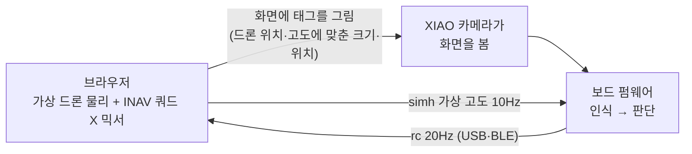

# 10. 도구·시뮬레이터

## 모니터 (`tools/tag_monitor.py`)

보드의 JSON 출력을 한글로 풀어 보여준다. USB와 블루투스를 모두 지원한다.

```bash
python3 tools/tag_monitor.py                        # USB 실시간 해석
python3 tools/tag_monitor.py --snap view.jpg        # 카메라 화면 저장
python3 tools/tag_monitor.py --cmd "tags"           # 명령 보내고 계속 보기
python3 tools/tag_monitor.py --raw                  # JSON 원문
uv run --with bleak --with pyserial python3 tools/tag_monitor.py --ble   # 블루투스
```

- 표시 항목: `[판단]`(목표 태그, 이동, 다음 단계), `[MTF-01P]`, `[MSP→FC]`(보낸 값과 FC가 쓰는 값), `[카메라]`, `[마이크]`, `[음성 명령]`
- 스냅샷은 줄 사이에 끼어든 JSON을 걸러내고, base64 길이가 예상과 다르면 경고한다.
- USB 포트를 열면 보드가 재부팅될 수 있다. 블루투스는 재부팅하지 않는다.

## 마이크 도구 (`tools/voice_tool.py`)

[09](09-voice-mic.md)를 참고한다. `level`, `rec`, `collect`, `cmd` 기능이 있다.

## 브라우저 시뮬레이터 (`sim/index.html`)

드론 없이 **실제 보드의 카메라와 펌웨어**로 미션 전체를 시험한다(하드웨어 인 더 루프).



**실행**
```bash
python3 -m http.server 8000 -d sim    # Chrome에서 http://localhost:8000
```
1. **USB 연결** 또는 **블루투스 연결**을 누른다. 목록에는 Espressif 장치 또는 `TagBoard`만 나와 FC에 잘못 연결되지 않는다.
2. **카메라 화면 보기**로 카메라가 왼쪽 흰 영역을 보는지 확인한다. 거리는 25~35cm, 화면 밝기는 최대로 둔다.
3. **자동 보정**을 누른다. 태그를 세 곳에 그려 카메라의 회전·반전·중심 어긋남을 구한다.
4. **리셋 → 시작**을 누른다.

**시험 가능한 상황:** 바람·돌풍, 태그 가리기(놓침), 보드 MSP 끊기(INAV 복귀), 조종권 전환, ANGLE/POSHOLD 모드, 태그 크기(저고도 이탈)

**모델 가정**
- 이 FC 설정값을 반영했다: `nav_manual_speed` 750cm/s, 최대 기울기 45°, 호버 1300, 데드밴드 ±10µs
- POSHOLD에서는 FC가 바람의 85%를 상쇄한다고 가정했다.
- 이 FC는 실제로는 POSHOLD를 쓸 수 없다([07](07-fc-msp-integration.md)).

**검증 기록 (헤드리스 Chrome)**
- 화면 태그를 AprilTag 검출기로 확인했다. ID 10으로 인식됐고, 위치 오차는 0.3px 이하, 화면에서 잰 오프셋은 실제와 일치했다.
- 보드 대신 같은 제어식을 쓰는 가짜 보드로 폐루프를 돌렸다(지연 0.3초, 옆바람 20cm/s). 미션 전 단계를 13초에 완료했지만, 처음 정렬에서 약 15cm를 지나쳤다.
- **실제 보드로는 아직 실행하지 않았다.**

## PC 테스트 (`tag-board-fw/test/`)

| 테스트 | 확인 내용 | 결과 |
|---|---|---|
| `msp_host_test.cpp` + `check_msp.py` | MSP 프레임 생성(헤더·체크섬·채널·리틀엔디언)을 규격대로 독립 해석, 응답 파서(잡음·체크섬 오류·FC 거부) | 통과 |
| `mtf_host_test.cpp` | 보드가 실제로 받은 MSP 모드 바이트로 MTF 파서, 플로우 단위 변환, Micolink 프레임 | 통과 (1709mm 해석) |
| `adpcm_host_test.cpp` + `check_adpcm.py` | 보드 ADPCM 인코더 → Python 해독기 왕복 | SNR 32.2dB, 통과 |

```bash
cd tag-board-fw
clang++ -std=c++17 -I src test/msp_host_test.cpp -o /tmp/msp_test && /tmp/msp_test | python3 test/check_msp.py
clang++ -std=c++17 -I src test/mtf_host_test.cpp -o /tmp/mtf_test && /tmp/mtf_test
clang++ -std=c++17 -I src test/adpcm_host_test.cpp -o /tmp/adpcm_test && /tmp/adpcm_test | python3 test/check_adpcm.py
```
