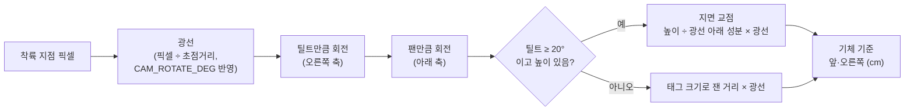

# 13. 카메라 팬·틸트

> 상태 (2026-10-10): 펌웨어 `-21`에 코드 작성 (**빌드·PC 시험·업로드 전**). 서보와 브래킷은 아직 장착하지 않았다.

## 요구

- 2026-10-10 사용자: **"운행 중에 카메라가 방향을 틀 수 있어야 한다."**
- 방식: 서보 2개로 팬(좌우)·틸트(위아래) (사용자 선택)
- 지금은 보드를 뒤집어 고정해 카메라가 항상 기체 아래를 본다.

## 하드웨어 안

| 항목 | 권장 |
|---|---|
| 서보 | **MG90S 2개** (금속 기어, 9g급). SG90도 된다. 표준 50Hz PWM 서보면 모델은 상관없고 펄스 범위는 `config.h`에서 보정한다 |
| 브래킷 | 2축 팬·틸트. 아래 서보가 팬(수직축), 그 위 서보가 틸트 |
| 신호 | 팬 → XIAO **D8**(GPIO7), 틸트 → XIAO **D9**(GPIO8). 두 구멍 모두 비어 있음(10-10 사진) |
| 전원 | FC 5V. LED·BUZZER 또는 GPS 커넥터의 5V·GND를 쓴다(둘 다 비어 있음). **XIAO 3V3 금지.** GND 공통 |
| 카메라 장착 | (a) XIAO Sense 전체를 브래킷에 올림: UART5·마이크 선이 움직임을 따라가도록 여유가 필요하다. (b) **긴 FPC 카메라**(OV2640 24핀, 예: 75mm)로 바꿔 카메라만 브래킷에 올리고 보드는 고정: 선이 덜 움직여 권장한다 |

## 각도 규약 (기체 기준)

| 축 | 0° | + 방향 | 범위 |
|---|---|---|---|
| 팬 | 기체 앞 | 오른쪽 (위에서 보면 시계방향) | −90° ~ +90° |
| 틸트 | **바로 아래** (지금 고정 장착 자세) | 앞쪽으로 들어 올림, 90° = 정면 수평 | −30° ~ +90° |

## 위치 계산 (`src/gimbal_geom.h`)

- **팬 0°·틸트 0°에서는 기존 방식(cm/px)과 같은 값이 나온다.** 초점거리가 약분되기 때문이다.
- 비스듬히 보면 태그가 짧아 보여, 태그 크기로 잰 거리가 실제보다 길게 나온다. 그래서 틸트가 20° 이상이면 높이(FC 거리센서, [06](06-sensor-mtf01p.md))로 지면 교점을 구한다.
- 광선이 수평 아래 10°보다 얕으면(정규화한 아래 성분 0.17 미만) 지면 교점을 쓰지 않는다. 너무 멀거나 교점이 없기 때문이다.
- 높이는 기체 바로 아래까지의 거리다. **기체 기울기 보정은 아직 없다.** FC 자세(`MSP_ATTITUDE`)를 읽어 광선을 한 번 더 돌리는 방법을 후보로 둔다.

계산 예 (높이 100cm, 화면 중심):

| 팬 | 틸트 | 가리키는 곳 |
|---|---|---|
| 0° | 0° | 바로 아래 |
| 0° | 45° | 앞 100cm |
| 90° | 45° | 오른쪽 100cm |
| −90° | 45° | 왼쪽 100cm |
| 0° | 60° (`cam front`) | 앞 약 173cm |

## 제어에 쓰는 조건

- 카메라가 움직이는 중이거나, 멈춘 지 250ms(`GIMBAL_SETTLE_MS`)가 안 됐으면 그 프레임의 위치는 **제어에 쓰지 않는다.** 스틱은 중립이고, `target` 메시지는 `decision:"GIMBAL_MOVING"`, `control_use:false`다.
- 각도를 모르는 상태(`cam off`, `cam us`)면 `decision:"NO_GEOMETRY"`다.
- 서보는 최대 120°/s(`GIMBAL_SLEW_DEG_S`)로 천천히 움직인다. 영상 번짐과 기체 흔들림을 줄이기 위해서다.

## 명령

| 명령 | 동작 |
|---|---|
| `cam` | 상태 출력 (`gimbal` 메시지) |
| `cam <팬°> <틸트°>` | 각도 지정 (범위로 자름) |
| `cam down` | 팬 0°, 틸트 0° (정렬·착륙) |
| `cam front` | 팬 0°, 틸트 60° (앞쪽 30° 아래, 멀리 있는 태그 찾기) |
| `cam off` | 신호를 끊어 서보 힘을 뺌 (각도 모름) |
| `cam us <팬µs> <틸트µs>` | 장착 보정용 펄스 직접 지정 (각도 모름) |

- 음성 키워드: `cam_down`("카메라 아래"), `cam_front`("카메라 앞")
- 부팅하면 팬 0°·틸트 0°(바로 아래)로 간다.

## 설정 (`config.h`, `-21`)

| 항목 | 값 |
|---|---|
| `GIMBAL_ENABLED` | true. 서보를 달지 않고 고정 장착을 유지한다면 false (항상 0°/0°로 계산) |
| 핀 | D8 = GPIO7 팬, D9 = GPIO8 틸트 |
| PWM | LEDC 채널 2·3(타이머 1), 50Hz, 14비트. 카메라 XCLK(타이머 0·채널 0)와 겹치지 않음 |
| 펄스 | 0° = 1500µs, 10µs/°, 500~2500µs로 자름 |
| 보정값 | `GIMBAL_PAN_CENTER_US`, `GIMBAL_TILT_DOWN_US`, `GIMBAL_PAN/TILT_US_PER_DEG` (도는 방향이 반대면 음수) |
| 판단 | `GIMBAL_SETTLE_MS` 250, `GIMBAL_OBLIQUE_DEG` 20, `GIMBAL_MIN_DOWN` 0.17, `GIMBAL_FRONT_TILT_DEG` 60 |

## 보정 절차 (장착 후)

1. 프로펠러를 떼고 기체를 평평한 곳에 둔다. `cam us 1500 1500`.
2. **팬 0°:** 카메라 화면 위쪽이 기체 앞을 보는 펄스를 찾는다 → `GIMBAL_PAN_CENTER_US`
3. **틸트 0°:** 태그를 기체 바로 아래에 두고 화면 중심에 오는 펄스를 찾는다 → `GIMBAL_TILT_DOWN_US`
4. **각도당 펄스:** `cam 0 45`에서 실제로 45°인지 확인한다 → `GIMBAL_*_US_PER_DEG`
5. **검증:** 높이 100cm에서 태그를 앞 100cm 바닥에 두고 `cam 0 45` → `target`의 `body_fwd_cm`가 약 100이고 `range_src:"height"`인지 본다.
6. 축 방향 확인(`AXES_VERIFIED`)과 함께 기록한다.

## 다음에 정할 것: 자동 동작

| 방식 | 동작 |
|---|---|
| 찾기 | 태그가 안 보이면 앞쪽(틸트 60°)에서 좌우로 훑는다 |
| 따라가기 | 태그가 보이면 화면 중앙에 오도록 서보가 따라간다. 위치는 각도로 계산한다 |
| 착륙 | 정렬·고도 단계에서는 바로 아래(0°/0°)를 본다 |

- 10-10에 사용자에게 물었고 답을 기다리는 중이다. 권장안은 세 가지를 미션 단계에 따라 자동으로 바꾸는 것이다.

## 남은 일

1. `test/gimbal_host_test.cpp` 작성·실행 (위 계산 예 값으로 검증)
2. 빌드·업로드 (XIAO USB를 다시 연결해야 함)
3. 서보·브래킷 장착과 보정
4. 자동 동작(찾기·따라가기·착륙) 구현
5. 기체 기울기 보정 (`MSP_ATTITUDE`)
