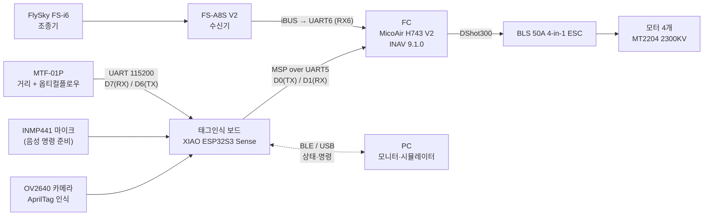

# 01. 시스템 개요

## 목표

노션 계획서(20260930~20261001)의 목표는 다음과 같다.

- 바닥의 AprilTag를 카메라로 찾아 그 위로 이동한다.
- 바닥 기준 50cm에서 3초 머문 뒤 100cm로 올라가 호버링한다.
- 태그인식 보드는 판단만 하고 FC에 이동 명령을 보낸다. 균형 유지와 모터 제어는 FC가 맡는다.
- 사람은 조종기 스위치로 보드에게 조종권을 주거나 되찾는다.
- 보드가 멈추거나 통신이 끊겨도 사람이 조종을 되찾을 수 있어야 한다.

## 전체 구성

- 수신기는 FC에 직접 연결한다. 보드가 멈춰도 조종기 입력은 FC에 닿는다.
- 보드는 FC에 조종 채널 값(롤·피치·스로틀·요)을 MSP로 보낸다.
- 이 값은 INAV의 **MSP RC OVERRIDE** 모드가 켜져 있을 때만, 그리고 지정한 채널에만 적용된다. 자세한 내용은 [07](07-fc-msp-integration.md)에 있다.

## 부품

| 구분 | 부품 | 상태 |
|---|---|---|
| 태그인식 보드 | Seeed XIAO ESP32S3 Sense (OV2640 카메라 확장 보드 포함) | 동작 중 |
| 거리·플로우 센서 | MicoAir MTF-01P | 동작 중 (현재 MSP 출력 모드) |
| 마이크 | INMP441 (I2S) | 배선 완료, 펌웨어 `-18` 업로드 대기 |
| FC | MicoAir H743 V2 (보드 표기 MicoAir743 V2.1), INAV 9.1.0 | 동작 중 |
| 수신기 · 조종기 | FlySky FS-A8S V2 · FS-i6 | 동작 중 (iBUS, 6채널로 추정) |
| ESC · 모터 | BLS 50A 4-in-1 · ReadyToSky MT2204 2300KV ×4 | **모터 시험에서 돌지 않음** |
| 기체 | 전용 프레임, 약 80% 완성 (노션 기준) | 제작 중 |
| 시각 표식 | AprilTag tag36h11 ID 10, 한 변 200mm 패널 | 제작 완료 |
| | ID 0, 한 변 100mm (저고도용) | 출력 예정 |

## 진행 경과 (2026-10-03)

1. 노션 계획서를 가져와 정리했다.
2. 보드에 있던 `RIDER-SERIAL-20260924-06` 펌웨어의 출력(MTF-01P JSON)을 분석하고, 플래시 8MB 전체를 백업했다.
3. 카메라 + AprilTag + MTF-01P 펌웨어를 새로 만들어 올렸다. 패널 태그는 ID 10으로 인식됐다.
4. 태그별 크기·착륙 지점 오프셋(중첩 태그)과 decimate 자동 전환을 넣었다.
5. FC로 보내는 MSP 송신, 미션 단계, 안전 장치를 넣었다.
6. 브라우저 시뮬레이터(화면에 태그를 그려 실제 카메라로 보는 폐루프)를 만들었다.
7. FC 설정 전체를 읽어 문서로 정리했다.
8. MTF-01P 출력 형식 변경(MSP)에 대응했고, 블루투스(BLE) 연결을 넣어 안정화했다.
9. FC와의 MSP 통신을 확인했다. UART5를 켜고 신호선을 바꾼 뒤 정상이 됐다.
10. 모터 시험 명령으로 신호를 보냈다. FC는 받았지만 모터는 돌지 않았다.
11. INMP441 마이크와 음성 명령 구조를 만들었다(업로드 대기).

자세한 측정값은 [11. 시험 기록](11-test-log.md)에 있다.
